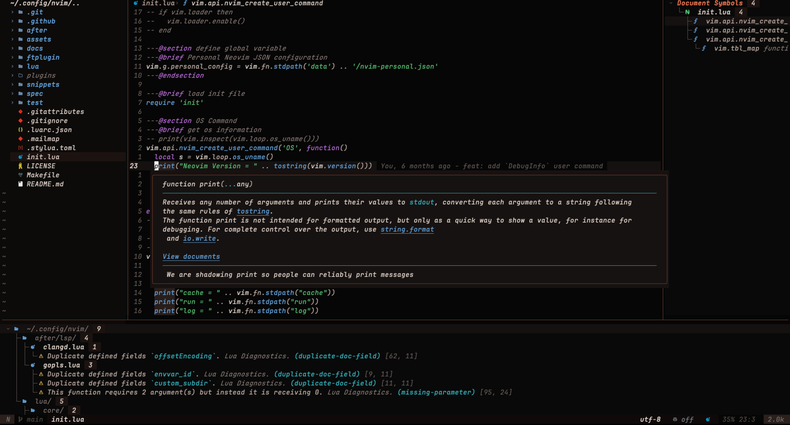

# grayveil.nvim

Soft gray and ember-dark Neovim colorschemes tuned for calm, readable coding.

| `grayveil` | `emberveil` |
| --- | --- |
|  |  |

## Themes

- `grayveil`: a light gray palette with muted, low-saturation syntax colors.
- `emberveil`: a dark terminal-inspired palette with black surfaces, warm orange accents, and softened syntax colors.

## Features

- Clear editor surfaces with distinct supporting panels.
- Highlight support for Treesitter, LSP semantic tokens, Telescope, nvim-tree, Trouble, nvim-cmp, Mason, Lazy, Noice, dropbar, GitSigns, and lualine.
- Optional transparent background and terminal color support.

## Install

With [lazy.nvim](https://github.com/folke/lazy.nvim):

```lua
{
  "ZhiWei-Ou/grayveil.nvim",
  priority = 1000,
  config = function()
    require("grayveil").setup({
      transparent = false,
      terminal_colors = true,
    })
  end,
}
```

Then enable it:

```vimdoc
:colorscheme grayveil
:colorscheme emberveil
```

## Options

```lua
require("grayveil").setup({
  transparent = false,
  terminal_colors = true,
})
```

## Test

Run the headless Neovim smoke tests:

```sh
make test
```

## License

Apache-2.0
