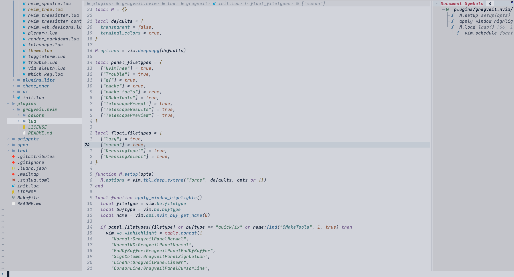

# grayveil.nvim

A soft gray Neovim colorscheme tuned for calm, readable coding.



## Features

- Light gray palette with muted, low-saturation syntax colors.
- Clearer editor surface with darker supporting panels.
- Highlight support for Treesitter, LSP semantic tokens, Telescope, nvim-tree, Trouble, nvim-cmp, Mason, Lazy, Noice, dropbar, GitSigns, and lualine.
- Optional transparent background and terminal color support.

## Install

With [lazy.nvim](https://github.com/folke/lazy.nvim):

```lua
{
  "ZhiWei-Ou/grayveil.nvim",
  priority = 1000,
  config = function()
    require("grayveil").setup({
      transparent = false,
      terminal_colors = true,
    })
  end,
}
```

Then enable it:

```vim
:colorscheme grayveil
```

## Options

```lua
require("grayveil").setup({
  transparent = false,
  terminal_colors = true,
})
```

## License

Apache-2.0
